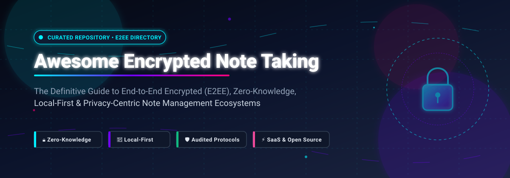

# 🔐 Awesome Encrypted Note Taking

 
 

<!-- Badges Header -->

  <strong>Curated directory of End-to-End Encrypted (E2EE), Zero-Knowledge, Local-First, and Privacy-Focused Note Management Ecosystems.</strong>

  <a href="#-sector-overview--market-dynamics">📈 Sector Overview</a> •
  <a href="#-saashosted-platforms-comparison">☁️ SaaS Platforms</a> •
  <a href="#-open-source-github-projects">💻 Open-Source Repos</a> •
  <a href="#-key-cryptographic-concepts">🔑 Security Concepts</a> •
  <a href="#-how-to-contribute">🤝 Contribute</a>

---

## 📖 Introduction & SEO Overview

Welcome to **Awesome Encrypted Note Taking** — your comprehensive, open-source guide and evaluation matrix for secure, encrypted, and privacy-first note-taking software. 

Whether you are looking for **End-to-End Encryption (E2EE)**, **Zero-Knowledge Architecture**, **Local-First Personal Knowledge Management (PKM)**, or audited **Self-Hosted Markdown sync backends**, this repository benchmarks the best cloud SaaS and open-source applications to safeguard your intellectual property, personal journals, research, and confidential notes against unauthorized surveillance and data breaches.

### 🎯 Key Evaluation Pillars
- 🔒 **True Zero-Knowledge Encryption**: Only the user holds the encryption and decryption keys (AES-256, XChaCha20-Poly1305, Argon2id).
- 📂 **Local-First Architecture**: Your data is always saved on your local filesystem in interoperable formats (e.g., Markdown/SQLite) before syncing.
- 🌐 **Audited Cryptographic Implementations**: Transparent client and server source code verifiable by independent security auditors.
- 🔄 **Cross-Platform Sync & Interoperability**: Seamless synchronization across Linux, macOS, Windows, iOS, Android, and web without leaking metadata.

---

## 📑 Table of Contents
- [📈 Sector Overview & Market Dynamics](#-sector-overview--market-dynamics)
- [☁️ SaaS/Hosted Platforms Comparison](#-saashosted-platforms-comparison)
- [💻 Open-Source GitHub Projects](#-open-source-github-projects)
- [🔑 Key Cryptographic Concepts & Glossary](#-key-cryptographic-concepts--glossary)
- [🤝 How to Contribute](#-how-to-contribute)
- [⚖️ Disclaimer & Security Advisory](#️-disclaimer--security-advisory)

---

## 📈 Sector Overview & Market Dynamics

The global note-taking and collaborative workspace management software market is estimated at **$7.2 billion in 2025/2026** and is projected to expand to **$14.8 billion by 2032**, registering a robust compound annual growth rate (**CAGR of ~11.6%**). Growth is powered by remote work expansion, AI-assisted productivity pipelines, and stricter global privacy mandates (GDPR, HIPAA, and CCPA).

From a market structure standpoint, the sector is **moderately fragmented**:
- **Mass-Market Distribution Concentration**: Big Tech incumbents (Apple, Microsoft, Google) hold overwhelming passive distribution by bundling native note-taking applications across hundreds of millions of pre-activated operating systems and cloud subscriptions.
- **Privacy & Security Fragmentation**: In the specialized **End-to-End Encryption (E2EE)** and **Local-First / Self-Hosted** subsectors, there is no single dominant winner. Instead, a vibrant, fragmented ecosystem thrives (e.g., Standard Notes/Proton, Joplin, Notesnook, Obsidian, AFFiNE, and AppFlowy). Privacy-conscious developers, security researchers, and enterprise users actively resist centralized vendor lock-in, prioritizing client-side cryptographic guarantees, open formats (plain Markdown), and self-hosted sync sovereignty.

---

## ☁️ SaaS/Hosted Platforms Comparison

The following table provides a comprehensive evaluation of hosted note-taking platforms, comparing their corporate valuation/revenue footprint, cryptographic models, exact starting commercial pricing tiers, and specific free tier or free trial constraints.

> [!NOTE]  
> The table is sorted in **descending order by company size** (market capitalization, private valuation, or estimated annual revenue).

| 🏢 Platform / Service | 💼 Parent Company & Valuation / Size | 🔐 Encryption & Privacy Model | 💵 Starting Paid Pricing | 🎁 Free Tier Limits & Trial Specifications |
| :--- | :--- | :--- | :--- | :--- |
| **[Apple Notes](https://support.apple.com/en-au/102651)** | Apple Inc. *(~$3.4T Market Cap / $391B Rev)* | **Zero-Knowledge E2EE (Optional)** Client-side AES-256-GCM via **Advanced Data Protection (ADP)**. When ADP is disabled, encryption keys remain with Apple. | **$0.99 / month** *(iCloud+ 50 GB storage tier)* | **Free forever plan:** Free with any Apple ID; includes **5 GB shared iCloud storage** across all Apple services (Notes, Mail, Photos, Backups). Unlimited notes across unlimited Apple devices. |
| **[Microsoft OneNote](https://www.microsoft.com/en-us/microsoft-365/onenote)** | Microsoft Corp. *(~$3.1T Market Cap / $245B Rev)* | **Partial Encryption (At-Rest / In-Transit)** AES-128/256 password protection on individual sections only. Full notebooks are not E2EE; Microsoft manages cloud keys. | **$1.99 / month** *($19.99/yr for Microsoft 365 Basic, 100 GB)* | **Free forever plan:** Free with a Microsoft Account; shares a **5 GB pooled OneDrive cloud storage limit**. Unlimited notes and sections until 5 GB storage ceiling is reached. |
| **[Google Keep](https://keep.google.com/)** | Alphabet Inc. *(~$2.1T Market Cap / $307B Rev)* | **Server-Side Encryption Only** Data encrypted in transit (TLS 1.3) and at rest (AES-256). **No E2EE**; Google holds encryption keys and processes note metadata. | **$1.99 / month** *($19.99/yr for Google One Basic, 100 GB)* | **Free forever plan:** Free with Google Account; shares the **15 GB pooled Google Drive/Gmail storage pool**. Unlimited notes with up to 20,000 characters per note. |
| **[Notion](https://www.notion.com/)** | Notion Labs, Inc. *(~$10.0B Valuation / $250M+ ARR)* | **Server-Side Encryption Only** TLS in transit, AES-256 at rest on AWS. **No E2EE**; Notion maintains key ownership and can technically inspect workspace contents. | **$10.00 / user / month** *($8.00/user/mo billed annually for Plus plan)* | **Free forever plan:** Free for individual users; includes **unlimited pages/blocks**, up to 10 guest collaborators, **5 MB file attachment limit**, and 7-day page revision history. |
| **[Simplenote](https://simplenote.com/)** | Automattic Inc. *(~$3.0B Valuation / $300M+ Rev)* | **Server-Side Encryption Only** Encrypted in transit and at rest on Automattic servers. **No E2EE**; Automattic retains server-side decryption keys. | **$19.99 / month** *($199.99/yr optional Sustainer donation; 100% features free)* | **Free forever plan:** **100% free forever** for all core functionality; includes unlimited text notes, unlimited device synchronization, tags, Markdown support, and full version history without ads. |
| **[Evernote](https://evernote.com/)** | Bending Spoons S.p.A. *(~$2.55B Valuation / $200M+ Rev)* | **Partial Client-Side Encryption** Manual client-side passphrase encryption for selected text blocks only. Notebook sync is non-E2EE; Bending Spoons holds master server keys. | **$14.99 / month** *($99.00/yr billed annually for Starter plan)* | **Free forever plan:** Capped strictly at a maximum of **50 notes**, **1 single notebook**, **1 active device sync** at a time, 1 GB total monthly upload, and 20 tags. |
| **[Standard Notes (Cloud)](https://standardnotes.com/)** | Proton AG *(~$1.5B+ Valuation / $100M+ Rev)* | **Full Zero-Knowledge E2EE by Default** XChaCha20-Poly1305 with Argon2id key derivation. Zero metadata leakage; keys generated on client device. | **$90.00 / year** *($7.50/mo equivalent on Productivity tier)* | **Free forever plan:** Includes **unlimited notes**, **unlimited device synchronization**, full zero-knowledge E2EE, and offline access; **restricted to plain-text editor only** (no Markdown/rich-text), no file attachments, and session-only revision history. |
| **[Obsidian Sync](https://obsidian.md/sync)** | Dynalist Inc. *(~$20M ARR est. Bootstrap)* | **Full Zero-Knowledge E2EE (Default)** AES-256-GCM with scrypt key derivation. User password never sent to server; Dynalist cannot read vault notes. | **$5.00 / month** *($4.00/mo billed annually for Standard Sync)* | **Free trial only (for Sync service):** **14-day free trial** of Obsidian Sync with 1 vault and 1 GB storage limit. *(Note: The core Obsidian desktop/mobile app is free forever for personal use with unlimited local offline vaults).* |
| **[Bear](https://bear.app/)** | Shiny Frog Ltd. *(~$8M ARR est. Bootstrap)* | **Per-Note Client-Side AES-256** Encrypted notes use password/FaceID. Note sync operates through Apple CloudKit. Core app is local-first. | **$2.99 / month** *($29.99/yr for Bear Pro)* | **Free forever plan:** Free on a single Apple device with unlimited local notes, Markdown editor, and tags; **multi-device iCloud sync and note encryption locked behind Pro** *(includes a 14-day free trial)*. |
| **[Notesnook Pro](https://notesnook.com/)** | Streetwriters Pvt Ltd *(~$1.5M ARR est. Bootstrap)* | **Full Zero-Knowledge E2EE by Default** XChaCha20-Poly1305 encryption with Argon2id. Audited open-source clients and zero-knowledge synchronization architecture. | **$4.49 / month** *($34.99/yr for Pro tier)* | **Free forever plan:** Includes **unlimited encrypted notes**, up to **3 synced devices**, **50 MB cloud storage**, 50 notebooks, and 50 tags with full zero-knowledge encryption. |
| **[Joplin Cloud](https://joplinapp.org/cloud/)** | Laurent Cozic / Joplin Co. *(~$1.0M ARR est. Bootstrap)* | **Client-Side E2EE** AES-256-CBC client encryption. Notes and attachments are encrypted before leaving your hardware. | **€2.99 / month** *(~€2.40/mo billed annually at €28.69/yr Basic)* | **Free trial only (for Cloud hosting):** **14-day free trial** with 2 GB cloud storage and 10 MB per-attachment limit. *(Note: The Joplin application itself is 100% free forever when syncing via personal Nextcloud, WebDAV, or Dropbox).* |
| **[Cryptee](https://crypt.ee/)** | Cryptee OÜ *(~$500K ARR est. Bootstrap)* | **Full Zero-Knowledge E2EE by Default** Client-side AES-256-GCM encryption in browser/PWA. No metadata, no IP logging, European privacy jurisdiction (Estonia). | **€3.00 / month** *(~€36.00/yr for 10 GB plan)* | **Free forever plan:** Includes **100 MB encrypted cloud storage**, unlimited documents/notes, ghost albums, PDF viewer, and zero-knowledge privacy guarantees. |

---

## 💻 Open-Source GitHub Projects

The following curated open-source repositories represent the pinnacle of **auditable, local-first, self-hostable, and end-to-end encrypted** note-taking tools. 

> [!TIP]  
> The projects are sorted in **descending order by GitHub star count**. Click any star badge to inspect the real-time stargazers community!

---

### 1. 🗂️ [AppFlowy](https://github.com/AppFlowy-IO/AppFlowy) 
- **Primary Language:** Flutter / Rust / Dart
- **License:** AGPL-3.0
- **Architectural Highlights:** Open-source, local-first privacy-centric alternative to Notion. Built with a Rust core engine and Flutter UI, ensuring 100% data ownership on your local hard drive. Supports self-hosted synchronization with encrypted SQLite storage backends and native cross-platform offline editing.

---

### 2. 🎨 [AFFiNE](https://github.com/toeverything/AFFiNE) 
- **Primary Language:** TypeScript / Rust
- **License:** MIT
- **Architectural Highlights:** Privacy-first, local-first workspace merging docs, whiteboards, and database tables. Operates with Conflict-free Replicated Data Types (CRDTs), peer-to-peer sync protocols, and zero-knowledge client-side encryption options, ensuring server providers cannot read raw page blocks.

---

### 3. 📝 [Memos](https://github.com/usememos/memos) 
- **Primary Language:** Go / TypeScript
- **License:** MIT
- **Architectural Highlights:** Lightweight, self-hosted privacy-first micro-blogging and memo engine. Markdown native with zero tracking. Can be hosted locally in a lightweight Docker container behind encrypted reverse proxies, SQLite with SQLCipher encryption, or private VPN tunnels.

---

### 4. 📓 [Joplin](https://github.com/laurent22/joplin) 
- **Primary Language:** TypeScript / JavaScript
- **License:** AGPL-3.0
- **Architectural Highlights:** The classic open-source Markdown note-taking powerhouse. Full client-side End-to-End Encryption (AES-256-CBC) before syncing across Joplin Cloud, Nextcloud, WebDAV, Dropbox, or OneDrive. Features PDF annotations, Web Clipper, end-to-end encrypted note sharing, and geo-location tracking controls.

---

### 5. 🧱 [SiYuan](https://github.com/siyuan-note/siyuan) 
- **Primary Language:** Go / TypeScript
- **License:** AGPL-3.0
- **Architectural Highlights:** Privacy-first, local-first personal knowledge management (PKM) system supporting granular block-level reference and bidirectionally linked graphs. Data is stored entirely locally in JSON/Markdown format with end-to-end cloud sync encryption and password-protected repository backups.

---

### 6. 🌲 [Logseq](https://github.com/logseq/logseq) 
- **Primary Language:** Clojure / ClojureScript
- **License:** AGPL-3.0
- **Architectural Highlights:** A privacy-first, local-first outliner and knowledge base with bidirectional linking, PDF annotations, and daily journal workflows. All notes live locally as plain-text Markdown or Org-mode files on your device. Enables Git version control sync with custom GPG encryption.

---

### 7. 🌳 [Trilium Notes](https://github.com/TriliumNext/Trilium) 
- **Primary Language:** JavaScript
- **License:** AGPL-3.0
- **Architectural Highlights:** Hierarchical note-taking application designed for constructing large, deeply nested knowledge bases. Offers granular per-note encryption (using strong client passphrases), custom scripts, automated tree restructuring, and self-hosted server-to-desktop synchronization.

---

### 8. 🧼 [Foam](https://github.com/foambubble/foam) 
- **Primary Language:** TypeScript
- **License:** MIT
- **Architectural Highlights:** Personal knowledge management and sharing system built on top of Visual Studio Code. Because it relies on standard Markdown files, users gain total file ownership and can pair repositories with Git-crypt, Keybase, or encrypted disk volumes for military-grade protection.

---

### 9. 🛡️ [Notesnook](https://github.com/streetwriters/notesnook) 
- **Primary Language:** TypeScript / JavaScript
- **License:** GPL-3.0
- **Architectural Highlights:** 100% open-source, zero-knowledge private note taking app. Client-side encryption utilizes XChaCha20-Poly1305 and Argon2id. Features rich-text editing, attachments, reminders, password-locked vaults, and a self-hostable synchronization server.

---

### 10. 🌐 [Anytype](https://github.com/anyproto/anytype-ts) 
- **Primary Language:** TypeScript / Go
- **License:** Any Source Available License (Open Code)
- **Architectural Highlights:** Local-first, decentralized, P2P encrypted workspace operating on the Any-Sync protocol. Built with block-level encryption, IPFS-inspired distributed structures, and zero-knowledge identity based on cryptographic seed phrases.

---

### 11. 🧠 [Reor](https://github.com/reorproject/reor) 
- **Primary Language:** TypeScript
- **License:** GPL-3.0
- **Architectural Highlights:** AI-powered desktop note-taking app that is completely local-first and privacy-focused. Runs local LLMs (via Ollama or Llama.cpp) directly on your device. Generates vector embeddings for your notes locally without ever sending sensitive writing to third-party cloud APIs.

---

### 12. 🌲 [Dendron](https://github.com/dendronhq/dendron) 
- **Primary Language:** TypeScript
- **License:** AGPL-3.0
- **Architectural Highlights:** Local-first, hierarchical Markdown-based personal knowledge base built as a VS Code extension. Leverages schema-based hierarchy, backlinks, and plain text files. Works seamlessly with git-crypt, VeraCrypt, or disk-level BitLocker/LUKS encryption.

---

### 13. 🔐 [Standard Notes](https://github.com/standardnotes/app) 
- **Primary Language:** TypeScript
- **License:** AGPL-3.0
- **Architectural Highlights:** The pioneer and standard-bearer of open-source zero-knowledge note-taking. Audited cryptographic protocols with XChaCha20-Poly1305 encryption. Features open-source client apps across all operating systems and a fully self-hostable backend sync server.

---

### 14. ⚡ [SilverBullet](https://github.com/silverbulletmd/silverbullet) 
- **Primary Language:** TypeScript
- **License:** MIT
- **Architectural Highlights:** Extensible, local-first personal knowledge management system written in TypeScript. Notes are saved as pure Markdown files on your own filesystem. Can be self-hosted on encrypted hardware or accessed as an offline-first progressive web application (PWA).

---

### 15. 📷 [Cryptee Web Client](https://github.com/cryptee/web-client) 
- **Primary Language:** JavaScript / CSS
- **License:** GPL-3.0
- **Architectural Highlights:** Open-source progressive web app (PWA) client for Cryptee's zero-knowledge encrypted notes and photo storage service. Implements client-side AES-256-GCM encryption with ghost albums, zero metadata logging, and strict air-gapped security models.

---

## 🔑 Key Cryptographic Concepts & Glossary

When choosing an encrypted note-taking app, understanding these security distinctions is paramount:

| Concept | Explanation & Threat Model |
| :--- | :--- |
| **End-to-End Encryption (E2EE)** | Data is encrypted on the originating client device and only decrypted on authorized recipient devices. The cloud sync server or hosting provider receives only ciphertext. Even with a subpoena or database breach, the provider cannot decrypt your notes. |
| **Zero-Knowledge Architecture** | The service provider has zero technical means of decrypting user data. Your master passphrase never travels across the network in plaintext and is never saved in server memory or storage. |
| **Encryption-in-Transit (TLS)** | Protects your connection between your computer and the server (e.g., HTTPS). While it stops Wi-Fi eavesdroppers, the provider decrypts the notes once they reach their cloud server. |
| **Encryption-at-Rest (AES-256)** | Encrypts physical database disks in the cloud provider's data center. This guards against stolen physical hard drives, but the cloud platform still holds the decryption keys and can view your data. |
| **Local-First Architecture** | Software that stores its primary database/files on the user's local disk first, operating with full functionality offline. Sync is secondary and optional, eliminating cloud dependency and vendor lock-in. |

---

## 🤝 How to Contribute

We welcome contributions from developers, researchers, and privacy advocates worldwide!

1. 🍴 **Fork the Repository**: Click the Fork button at the top right of this page.
2. 🌿 **Create a Branch**: `git checkout -b add/my-secure-note-tool`
3. ✏️ **Make Your Additions**:
   - Ensure open-source projects have a public repository, verifiable license, and active development.
   - For SaaS tools, follow our tabular format: provide parent company valuation/size, encryption architecture, exact starting paid pricing, and specific free tier limits.
   - Add the social star badge linking to the repo's stargazers page.
4. 🧪 **Validate Formatting**: Ensure clean Markdown, alphabetical or sorted consistency, and proper links.
5. 🚀 **Submit a Pull Request**: Provide a concise summary of the addition and cryptographic properties.

---

## ⚖️ Disclaimer & Security Advisory

> [!CAUTION]  
> - **Verify Your Threat Model**: "Encrypted" does not automatically mean "End-to-End Encrypted." Always verify whether the vendor or software architecture holds master decryption keys before storing confidential or regulated information.
> - **Self-Hosting Responsibility**: Self-hosted solutions (e.g., Memos, Nextcloud, Joplin Server, Standard Notes Server) are only as secure as the host infrastructure. Always enforce HTTPS/TLS, automated encrypted off-site backups, firewall isolation, and strong SSH key authentication.
> - **Independent Audit**: While listed open-source tools have public source code, always check the date and scope of their most recent third-party security audits.

---

**⭐ Star this repository if it helps you secure your private knowledge base! ⭐**

Made with ❤️ for privacy advocates, researchers, developers, and data sovereignty champions.

